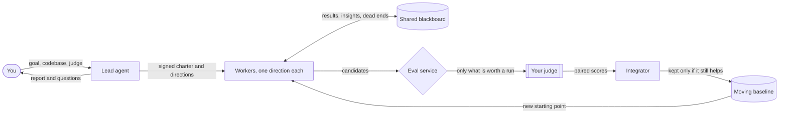

<div align="center">

# VLAH

**Very Large Agent Herd**

**Point a herd of AI agents at a hard optimization problem.<br>Come back to the changes that actually move your metric, already combined.**

[](#status-and-roadmap)
[](LICENSE)

[Quickstart](docs/quickstart.md) •
[Why a herd](#why-a-herd) •
[How it works](#how-it-works) •
[Python SDK](docs/sdk.md) •
[Design](docs/design.md)

</div>

---

> [!NOTE]
> **VLAH is pre-alpha.** The design is written and the code is being built now. The quickstart and SDK on this page show the interface we are building toward. They don't run yet. If it doesn't fit your problem, [tell us](#contributing) now, while it's cheap to change.

You have a metric that matters: a prompt-cache hit rate, p99 latency, or a pass rate on a benchmark you can't fake. Moving it takes changes in five different places, and each needs its own deep dive. The only number you trust comes from a benchmark that takes 30 minutes and can run twice an hour.

One agent can't hold all of that in its head. Ten agents working separately repeat each other's dead ends and burn your benchmark runs on duplicates.

**VLAH runs the agents as a team.** Each one takes a different direction, and they share everything they learn on a common blackboard. Plain code spends your scarce benchmark runs only where a result could change the next decision. Verified wins are stacked one at a time, and each is kept only if it still helps. You come back to one patch that combines everything that works together, and to a record of everything that didn't.

## What you come back to

Here is a mock-up of the report after an overnight run on a prompt-cache problem. The numbers are illustrative:

```console
$ vlah report cache-hit

  Goal     prompt-cache hit rate on harness-bench          (higher is better)
  Run      14h · 8 workers · 5 directions
  Judge    26 of 28 runs used · 9 duplicates skipped · 31 candidates stopped by cheap checks

  Baseline 41.2%  ->  63.5%   (+22.3 pts, paired, re-measured on held-out traces)

  Stacked, in the order merged (gain on the moving baseline)
    +11.8  stable tool-definition ordering               tools.py
    + 6.1  retrieved documents after the static prefix   context.py
    + 3.0  strip per-request timestamps                  prompt_builder.py
    + 1.4  cache-aware truncation                        context.py

  Helped alone, dropped when stacked
     reorder system-prompt sections (+2.2 alone)      ->  absorbed by stable tool ordering

  Dead ends (recorded, never retried)
     compress tool schemas       hit rate unchanged, latency +9%
     pin model per session       no effect

  -> report/combined.patch   report/attribution.md   report/merge-log.md
```

## Why a herd

- **Covers the whole problem.** Workers spread across directions, such as prompt order, tool definitions and context layout, instead of all piling onto the first idea.
- **Nothing learned is lost.** Every result, insight and dead end is written to an append-only blackboard that any worker can search. Relevant updates are routed to the workers who need them.
- **Nobody walks the same dead end twice.** A worker can't spend a judge run without first being shown similar candidates and known dead ends.
- **Your judge is never wasted.** An eval service owns the quota. It drops duplicates, runs cheap checks before expensive ones, and measures each candidate paired against the current baseline.
- **Wins stack.** Improvements merge one at a time onto a moving baseline and are re-measured there. The deliverable is the combination, not the best single attempt.
- **You stay in charge with about 30 minutes a day.** You agree a charter with a lead agent before the run. Anything big comes back to you as a question with options and a safe default.
- **Bring your own agent and your own infrastructure.** Any harness that speaks MCP can be a worker. Workers can run on your laptop, Kubernetes or Ray, and state can live in git, Redis or S3.
- **Every decision can be audited.** Agents do the thinking, and plain code decides what counts. Every decision is in the log.

## Is VLAH right for your problem?

| Your problem looks like… | Reach for |
| --- | --- |
| One obvious lever, and a fast evaluation | One coding agent in a loop, for example [autoresearch](https://github.com/karpathy/autoresearch) |
| One program or function, scored by a fast automatic evaluator you can call hundreds of times | LLM-guided evolutionary search: [AlphaEvolve](https://deepmind.google/discover/blog/alphaevolve-a-gemini-powered-coding-agent-for-designing-advanced-algorithms/), [OpenEvolve](https://github.com/algorithmicsuperintelligence/openevolve), [ShinkaEvolve](https://github.com/SakanaAI/ShinkaEvolve) |
| **Many areas of a real codebase, more context than one agent can hold, and a trusted evaluation that is slow and rationed** | **VLAH** |

Good fits include:
- prompt-cache hit rate of an agent harness;
- end-to-end latency of a service;
- pass rate on a gated benchmark;
- a scheduler or placement policy scored by a slow simulator.

## Quickstart

> Preview: this is the planned interface. See the [full quickstart](docs/quickstart.md).

```bash
git clone https://github.com/minyi-tang/vlah && cd vlah
uv sync

uv run vlah demo     # a toy problem, fully in memory: about 10 seconds, no API keys
```

Point it at your own problem:

```bash
uv run vlah init cache-hit --repo ~/code/my-harness   # scaffold a problem folder
$EDITOR cache-hit/herd.yaml                           # connect your judge; workers never see this file
uv run vlah chat cache-hit                            # agree the goal and directions, then sign
uv run vlah run cache-hit --workers 8                 # start the herd
uv run vlah report cache-hit                          # read the result; apply report/combined.patch
```

### Use it from Python

```python
import vlah
from vlah.adapters import executors, harnesses, stores

herd = vlah.Herd(
    problem="cache-hit/",
    workers=8,
    executor=executors.Kubernetes(namespace="herd"),
    harness=harnesses.ClaudeCode(),
    store=stores.Stack(
        versioned=stores.Git("git@github.com:you/cache-hit-herd.git"),
        kv=stores.Redis("redis://redis:6379"),
        objects=stores.S3("herd-traces"),
    ),
)

run = herd.start()
for event in run.events():          # baseline_advanced, dead_end, escalation, ...
    print(event)

run.report().patch.write("cache-hit.patch")
```

The [SDK guide](docs/sdk.md) covers how to plug in your own judge, agent harness or infrastructure.

## How it works



1. **Align.** You describe the problem to a lead agent. It repeats the problem back in its own words, lists the assumptions it made, and proposes three to five directions. Nothing starts until you sign the charter.
2. **Explore.** Each worker attacks the whole problem from one direction, with full access to the code and the blackboard. Workers test ideas against cheap local proxies as often as they like.
3. **Spend the judge carefully.** To use a real judge run, a worker must predict the score and explain why. The eval service rejects duplicates and runs cheap checks first. Only the survivors reach your judge.
4. **Stack.** The integrator merges verified wins one at a time onto the baseline and re-measures each one there. Every worker then builds on the new baseline.

The [design overview](docs/design.md) explains why the system is built this way and how we will test that it works.

## Runs on your stack

VLAH is a standalone runtime that touches the outside world only through six ports. Each port has an in-memory adapter, so the whole herd runs in one process for tests.

| Port | What it is for | Adapters (planned) |
| --- | --- | --- |
| **Executor** | where workers run | local processes, Kubernetes, Ray |
| **Harness** | which agent does the work | Claude Code, Claude Agent SDK, OpenHands, your own loop |
| **SignalSource** | your judges, from unit tests to a slow benchmark to a human | any command, an HTTP service, a query |
| **Store** | blackboard, queues, artifacts | git, Redis, S3, sqlite-vec |
| **Human** | your channel to the lead agent | CLI, Slack |
| **Model** | which LLM each role uses | any provider; every role uses the strongest model |

## Status and roadmap

VLAH is built on a bet that hasn't been proven yet: **with the same time and the same judge budget, agents that share what they learn will beat the same agents working alone and merged the same way.** The first thing we ship is the experiment that tests this bet. We will publish the result whichever way it comes out.

- [x] Design ([overview](docs/design.md))
- [ ] Testbed: two synthetic problems with a deliberately slow judge, and an automatic scorecard
- [ ] Minimal herd running on the testbed, with in-memory and local adapters
- [ ] Head-to-head: one agent vs. isolated agents vs. the herd, pre-registered and scored on a sealed holdout
- [ ] Kubernetes, Redis and S3 adapters, plus the lead agent and Slack
- [ ] Real problems
- [ ] The herd improves its own code, scored by the testbed

## Related work

VLAH builds on these:
- [autoresearch](https://github.com/karpathy/autoresearch), which is one agent improving one training script overnight. VLAH asks what changes when you add many agents and the evaluation becomes scarce.
- LLM-guided evolutionary search: [FunSearch](https://github.com/google-deepmind/funsearch), [AlphaEvolve](https://deepmind.google/discover/blog/alphaevolve-a-gemini-powered-coding-agent-for-designing-advanced-algorithms/), [OpenEvolve](https://github.com/algorithmicsuperintelligence/openevolve) and [ShinkaEvolve](https://github.com/SakanaAI/ShinkaEvolve).
- The classic blackboard architecture from early AI systems, in which many specialists cooperate through one shared workspace.

## Contributing

The most useful contribution right now is a real problem. [Open an issue](https://github.com/minyi-tang/vlah/issues/new) and describe:
- the metric;
- the judge and how scarce it is;
- the areas you think matter.

Real cases shape the testbed and the API before either is fixed.

To change code or docs, read [CONTRIBUTING.md](CONTRIBUTING.md) for the lint setup and the pull request guidelines.

## License

[MIT](LICENSE)
