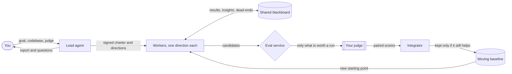

<div align="center">

# VLAH

**Very Large Agent Herd**

**Point a herd of AI agents at a hard optimization problem.<br>Come back to the changes that actually move your metric, already combined.**

[](#status-and-roadmap)
[](LICENSE)

[Quickstart](docs/quickstart.md) •
[Why a herd](#why-a-herd) •
[How it works](#how-it-works) •
[Python SDK](docs/sdk.md) •
[Design](docs/design.md)

</div>

---

> [!NOTE]
> **VLAH is alpha.** The herd runs end to end on a real problem, on one machine, in Docker and on Kubernetes (kind), with Claude Code or GitHub Copilot workers. Interfaces still change: parts of the quickstart and the Python SDK page describe what we are building rather than what runs today, and each page says which. [Status and roadmap](#status-and-roadmap) has the details and what the first runs showed. If it doesn't fit your problem, [tell us](#contributing) now, while it's cheap to change.

You have a metric that matters: a prompt-cache hit rate, p99 latency, or a pass rate on a benchmark you can't fake. Moving it takes changes in five different places, and each needs its own deep dive. The only number you trust comes from a benchmark that takes 30 minutes and can run twice an hour.

One agent can't hold all of that in its head. Ten agents working separately repeat each other's dead ends and burn your benchmark runs on duplicates.

**VLAH runs the agents as a team.** Each one takes a different direction, and they share everything they learn on a common blackboard. Plain code spends your scarce benchmark runs only where a result could change the next decision. Verified wins are stacked one at a time, and each is kept only if it still helps. You come back to one patch that combines everything that works together, and to a record of everything that didn't.

## What you come back to

Here is a mock-up of the report after an overnight run on a prompt-cache problem. The numbers are illustrative:

```console
$ vlah report cache-hit

  Goal     prompt-cache hit rate on harness-bench          (higher is better)
  Run      14h · 8 workers · 5 directions
  Judge    26 of 28 runs used · 9 duplicates skipped · 31 candidates stopped by cheap checks

  Baseline 41.2%  ->  63.5%   (+22.3 pts, paired, re-measured on held-out traces)

  Stacked, in the order merged (gain on the moving baseline)
    +11.8  stable tool-definition ordering               tools.py
    + 6.1  retrieved documents after the static prefix   context.py
    + 3.0  strip per-request timestamps                  prompt_builder.py
    + 1.4  cache-aware truncation                        context.py

  Helped alone, dropped when stacked
     reorder system-prompt sections (+2.2 alone)      ->  absorbed by stable tool ordering

  Dead ends (recorded, never retried)
     compress tool schemas       hit rate unchanged, latency +9%
     pin model per session       no effect

  -> report/combined.patch   report/attribution.md   report/merge-log.md
```

## Why a herd

- **Covers the whole problem.** Workers spread across directions, such as prompt order, tool definitions and context layout, instead of all piling onto the first idea.
- **Nothing learned is lost.** Every result, insight and dead end is written to an append-only blackboard that any worker can search. Relevant updates are routed to the workers who need them.
- **Nobody walks the same dead end twice.** A worker can't spend a judge run without first being shown similar candidates and known dead ends.
- **Your judge is never wasted.** An eval service owns the quota. It drops duplicates, runs cheap checks before expensive ones, and measures each candidate paired against the current baseline.
- **Wins stack.** Improvements merge one at a time onto a moving baseline and are re-measured there. The deliverable is the combination, not the best single attempt.
- **You stay in charge with about 30 minutes a day.** You agree a charter with a lead agent before the run. Anything big comes back to you as a question with options and a safe default.
- **Bring your own agent and your own infrastructure.** Any harness that speaks MCP can be a worker. Workers can run on your laptop, Kubernetes or Ray, and state can live in git, Redis or S3.
- **Every decision can be audited.** Agents do the thinking, and plain code decides what counts. Every decision is in the log.

## Is VLAH right for your problem?

| Your problem looks like… | Reach for |
| --- | --- |
| One obvious lever, and a fast evaluation | One coding agent in a loop, for example [autoresearch](https://github.com/karpathy/autoresearch) |
| One program or function, scored by a fast automatic evaluator you can call hundreds of times | LLM-guided evolutionary search: [AlphaEvolve](https://deepmind.google/discover/blog/alphaevolve-a-gemini-powered-coding-agent-for-designing-advanced-algorithms/), [OpenEvolve](https://github.com/algorithmicsuperintelligence/openevolve), [ShinkaEvolve](https://github.com/SakanaAI/ShinkaEvolve) |
| **Many areas of a real codebase, more context than one agent can hold, and a trusted evaluation that is slow and rationed** | **VLAH** |

Good fits include:
- prompt-cache hit rate of an agent harness;
- end-to-end latency of a service;
- pass rate on a gated benchmark;
- a scheduler or placement policy scored by a slow simulator.

## Quickstart

> Preview: this is the planned interface. See the [full quickstart](docs/quickstart.md).

```bash
git clone https://github.com/minyi-tang/vlah && cd vlah
uv sync

uv run vlah demo     # a toy problem, fully in memory: about 10 seconds, no API keys
```

Point it at your own problem:

```bash
uv run vlah init cache-hit --repo ~/code/my-harness   # scaffold a problem folder
$EDITOR cache-hit/herd.yaml                           # connect your judge; workers never see this file
uv run vlah chat cache-hit                            # agree the goal and directions, then sign
uv run vlah run cache-hit --workers 8                 # start the herd
uv run vlah report cache-hit                          # read the result; apply report/combined.patch
```

### Use it from Python

```python
import vlah
from vlah.adapters import executors, harnesses, stores

herd = vlah.Herd(
    problem="cache-hit/",
    workers=8,
    executor=executors.Kubernetes(namespace="herd"),
    harness=harnesses.ClaudeCode(),
    store=stores.Stack(
        versioned=stores.Git("git@github.com:you/cache-hit-herd.git"),
        kv=stores.Redis("redis://redis:6379"),
        objects=stores.S3("herd-traces"),
    ),
)

run = herd.start()
for event in run.events():          # baseline_advanced, dead_end, escalation, ...
    print(event)

run.report().patch.write("cache-hit.patch")
```

The [SDK guide](docs/sdk.md) covers how to plug in your own judge, agent harness or infrastructure.

## How it works



1. **Align.** You describe the problem to a lead agent. It repeats the problem back in its own words, lists the assumptions it made, and proposes three to five directions. Nothing starts until you sign the charter.
2. **Explore.** Each worker attacks the whole problem from one direction, with full access to the code and the blackboard. Workers test ideas against cheap local proxies as often as they like.
3. **Spend the judge carefully.** To use a real judge run, a worker must predict the score and explain why. The eval service rejects duplicates and runs cheap checks first. Only the survivors reach your judge.
4. **Stack.** The integrator merges verified wins one at a time onto the baseline and re-measures each one there. Every worker then builds on the new baseline.

The [design overview](docs/design.md) explains why the system is built this way and how we will test that it works.

## Runs on your stack

VLAH is a standalone runtime that touches the outside world only through six ports. Each port has an in-memory adapter, so the whole herd runs in one process for tests.

| Port | What it is for | Built | Planned |
| --- | --- | --- | --- |
| **Executor** | where workers run | local processes, Docker, Kubernetes (kind) | Ray, a real cluster |
| **Harness** | which agent does the work | Claude Code, GitHub Copilot CLI | Claude Agent SDK, OpenHands, your own loop |
| **SignalSource** | your judges, from unit tests to a slow benchmark to a human | any command, the testbed over HTTP | a query, a person |
| **Store** | blackboard, queues, artifacts | git (local and over HTTP), Redis, SQLite, sqlite-vec | S3 |
| **Human** | your channel to the herd | CLI inbox | Slack, the lead agent |
| **Model** | which LLM each role uses | any provider, through the harness; every role uses the strongest model | |

## Status and roadmap

VLAH is built on a bet that hasn't been proven yet: **with the same time and the same judge budget, agents that share what they learn will beat the same agents working alone and merged the same way.** The first thing we ship is the experiment that tests this bet. We will publish the result whichever way it comes out.

**As of 2026-11-01, VLAH is alpha.** The herd runs end to end on a real problem with real LLM workers, on one machine, in Docker containers and in Kubernetes pods on kind. Interfaces still change, and a stranger cannot yet follow the quickstart to the end. The roadmap with issue numbers is [#3](https://github.com/minyi-tang/vlah/issues/3); the questions only the maintainer answers are in [docs/open-questions.md](docs/open-questions.md).

### Where each piece stands

| Piece | State |
| --- | --- |
| Foundation: types, ports, in-memory adapters, test fakes | done |
| The 13 herd components: blackboard, indexer, merge queue, eval client, router, tools, local executor, worker harness, Integrator, budget and stop rules, runtime, egress sandbox, CLI | done, 2026-10-24 |
| Watch and steer a run: `vlah status`, `events`, `search`, `report`, `inbox`, `stop`, `demo`; durable runs with `--resume`; critic holdout checks | done |
| Local stack: scripted worker, Docker executor, blackboard over HTTP, Redis store, Kubernetes executor on kind, `vlah stack` | done, 2026-10-26 |
| Testbed: two synthetic problems, a slow judge, an automatic scorecard | built; problem A is not yet hard enough to serve as the gate ([#81](https://github.com/minyi-tang/vlah/issues/81)) |
| Testbed herd arm, `vlah arm run` | in review ([#122](https://github.com/minyi-tang/vlah/issues/122)) |
| Candidates as changes to a whole repository; the `report/` files | not started ([#117](https://github.com/minyi-tang/vlah/issues/117), [#118](https://github.com/minyi-tang/vlah/issues/118)) |
| Pilot and preregistration tooling | not started ([#124](https://github.com/minyi-tang/vlah/issues/124)) |
| Installable packages and releases | PRs open |
| S3 adapter, the lead agent, Slack | later |
| The herd improves its own code, scored by the testbed | later |

Tests: 754 collected, of which 30 are the L0 assertions from the design (none `xfail`), 17 need Docker or kind, 2 are the smoke tests. Every push runs lint, types, the default selection, the testbed self-checks, the Docker `infra` job and a check that git tracks no hidden testbed material. A nightly workflow runs the kind suite.

### What the first runs showed

A handful of short runs on one toy problem, [examples/prompt_optimization](examples/prompt_optimization/): improve the system prompt of a support assistant. A small assistant model answers hidden situations with the candidate prompt as its only instructions, and a grader scores each reply against a public policy handbook. The starting prompt scores about 0.35, the ceiling is near 1, and two runs of the same prompt differ by about 0.02. Workers are Claude Code sessions on Claude 5.5. None of this is a result about the bet; it is the first evidence that the mechanisms behave as designed, and two items changed the code.

**Sharing happens on its own, and isolation holds.** Two 20-minute runs side by side, four workers each, same judge, same Integrator ([#114](https://github.com/minyi-tang/vlah/pull/114)). S2 shares the blackboard; B1 gives each worker a view that holds only its own work.

| | S2 (shared) | B1 (isolated) |
| --- | --- | --- |
| Deliverable score, from 0.35 | 0.86 | 0.875 |
| Worker candidates judged | 27 | 27 |
| Merges kept | 1 | 3, all from one worker |
| Tool calls reading another worker's candidate | 71 | 0 |
| Claims citing another worker's claim or candidate | 65 | 0 |

In S2 every worker built on a baseline that held another worker's merge. One worker suspected judge noise and asked for the unchanged baseline to be rerun; another ran it, measured the noise at about ±0.01 to 0.02, refuted the suspicion and posted a 0.04 threshold for a meaningful gain. In B1 no worker touched a sibling's work. The two scores are within judge noise of each other, and one pair of runs says nothing about which arm wins.

**The same herd runs in containers with no change to the problem.** A 30-minute S2 run with two workers in Docker, state in Redis, the blackboard over HTTP ([#149](https://github.com/minyi-tang/vlah/pull/149)): 33 worker sessions, all exited and removed; 15 judge runs; two merges kept, taking baseline@0 at 0.34 to 0.8625; three critic jump alerts, all held on the audit set; a sealed holdout verdict of 0.845; and no denied network connection, because every session went through the egress proxy, which allowed only the tool server and the model gateway. On kind the LLM-free herd runs with the same event sequence and the boundary probe passes inside a pod ([#158](https://github.com/minyi-tang/vlah/pull/158)); a run with LLM workers on kind is still to do.

**A void measurement must never revert a merge.** In the first Claude Code run the grader ran out of tokens before printing its JSON on the closing audit. The core read the empty scores as "no audit gain" and reverted a merge that had taken the prompt from 0.39 to 0.83. A void remeasure or audit is now resubmitted twice and, if the judge still cannot score it, skipped with an error rather than treated as a result ([#114](https://github.com/minyi-tang/vlah/pull/114)).

**The spot-check threshold is too tight for a model-graded judge.** In the shared run it reverted the best prompt (0.90): the gain on the daily set was 0.55 and on the audit set 0.41, a gap of 0.14 against a threshold of 0.12. The threshold comes from the standard error of baseline@0's per-situation scores, which understates how much a gain differs between two sets of situations. Calibrating it from paired gains is an open follow-up.

**Most of what broke was plumbing.** The first three real runs each failed for a reason the unit tests could not see: the sandbox root sat inside the run directory, the sandbox profile denied the session's own log files, and a worker submitted its whole clone, `.git` included, as the candidate ([#109](https://github.com/minyi-tang/vlah/pull/109)). Each took one run to find and one fix. The lesson: run the real loop early and often, and treat every new executor as unproven until an LLM worker has gone through it.

### Next, in order

1. **Make the quickstart true.** Installable packages, whole-repository candidates ([#117](https://github.com/minyi-tang/vlah/issues/117)), the `report/` files ([#118](https://github.com/minyi-tang/vlah/issues/118)), and either build or remove the lead agent step. Done when a clean machine can follow [the quickstart](docs/quickstart.md) as written.
2. **Make the testbed gate real.** Problem A hard enough that one agent cannot reach the target in 30 minutes ([#81](https://github.com/minyi-tang/vlah/issues/81)), then the 5-worker B1 smoke through the scorecard.
3. **Preregister and run the comparison.** S2 against B1 plus the same merger, at 5 workers, on problem A. Needs the numbers in [docs/open-questions.md](docs/open-questions.md) and the pilot tooling ([#124](https://github.com/minyi-tang/vlah/issues/124)).

## Related work

VLAH builds on these:
- [autoresearch](https://github.com/karpathy/autoresearch), which is one agent improving one training script overnight. VLAH asks what changes when you add many agents and the evaluation becomes scarce.
- LLM-guided evolutionary search: [FunSearch](https://github.com/google-deepmind/funsearch), [AlphaEvolve](https://deepmind.google/discover/blog/alphaevolve-a-gemini-powered-coding-agent-for-designing-advanced-algorithms/), [OpenEvolve](https://github.com/algorithmicsuperintelligence/openevolve) and [ShinkaEvolve](https://github.com/SakanaAI/ShinkaEvolve).
- The classic blackboard architecture from early AI systems, in which many specialists cooperate through one shared workspace.

## Contributing

The most useful contribution right now is a real problem. [Open an issue](https://github.com/minyi-tang/vlah/issues/new) and describe:
- the metric;
- the judge and how scarce it is;
- the areas you think matter.

Real cases shape the testbed and the API before either is fixed.

To change code or docs, read [CONTRIBUTING.md](CONTRIBUTING.md) for the lint setup and the pull request guidelines.

## License

[MIT](LICENSE)
