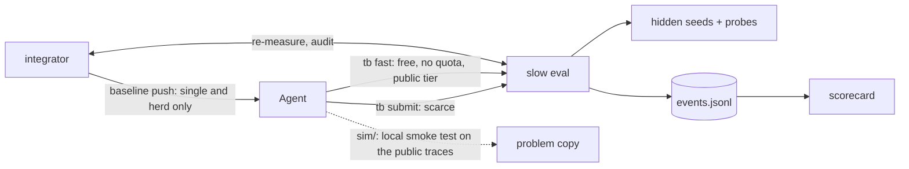

# Herd testbed

The test bench for the herd (spec: *Herd Testbed* §11; repo terms: issue #10). It checks whether a
herd *behaves* as designed on a cheap problem before we spend days on a real one, and it is the herd's
guardrail: a herd change that makes the scorecard worse on problem A is a regression.

It lives in this repo as `testbed/` (the Python package `testbed`, a uv workspace member),
`problems/` and `tests/testbed/`. It never imports `vlah`. The herd talks to it over HTTP, launches
through `tb run --arm herd`, and imports only `testbed.integrator` (plus the candidate hash in its
contract test).

What is here:

| Part | Where | What it is |
| --- | --- | --- |
| Problem A | `problems/sched/` | A SimPy cluster simulator with 6 sites. Agents write a scheduling policy (4 hooks + params). Five ingredients, a trap and a conflicting pair are planted in the sites. |
| Stub problem | `problems/stub/` | Score = a formula of the declared ingredients. Used by the scripted self-tests. |
| Slow tier | `testbed/slow_eval/` | The scarce judge: FastAPI + sqlite. Queue, shared quota, hidden seeds, results visible after a delay, CI and per-seed scores. |
| Recorder | `testbed/recorder/` | An append-only `events.jsonl` per run. The scorecard reads nothing else. |
| Scorecard | `testbed/scorecard/` | The nine metrics of spec §11.5, one run or several arms side by side. |
| Integrator | `testbed/integrator/` | Shared by all three arms (§11.8.1): FIFO, rebase, compose tasks, paired re-measure, acceptance rule, audit, bisect and revert, closing. |
| Arms | `testbed/arms/` | `tb run` for single / isolated / herd (§11.8), and the scripted fake herds (§11.9). |
| Extras | `testbed/extras/` | Quick validations beyond the spec (see below). |
| CLI | `tb` | `fast submit status history final` for workers; `serve pack-problem run precheck probes scorecard report selftest extras` for operators. |

Choices the spec left open, and where we departed from it, are in
[DECISIONS.md](https://github.com/minyi-tang/vlah/blob/main/testbed/DECISIONS.md).
Problem B (the broken harness) is not started; the spec says to wait for a go-ahead.

## Install

**Source checkout (editable):** from the repo root:

```bash
uv sync --all-packages          # the workspace, including the testbed and its tb command
uv run tb --help
source .venv/bin/activate       # optional: the commands below then work without "uv run"
```

**Built distributions:** Python 3.11 or later is required. Build locally; these commands do
not upload or release anything:

```bash
uv build --package vlah-testbed --no-sources
```

Install either `dist/vlah_testbed-0.1.0-py3-none-any.whl` or
`dist/vlah_testbed-0.1.0.tar.gz` into a fresh environment. The source archive contains
everything needed to build its wheel without the parent repository:

```bash
python -m venv /tmp/tb-env
/tmp/tb-env/bin/python -m pip install /absolute/path/to/vlah_testbed-0.1.0-py3-none-any.whl
cd /tmp
/tmp/tb-env/bin/python -I -c 'import testbed.integrator.core'
/tmp/tb-env/bin/tb --help
/tmp/tb-env/bin/tb pack-problem stub ./stub-worker
/tmp/tb-env/bin/tb fast ./stub-worker/policy --seed 1
```

The last command scores the public stub baseline at `-1000.0`; it needs no model, service,
or hidden data. `tb selftest --out ./selftest` exercises the scripted arms on the same stub.
For the scheduling simulator, use `tb pack-problem sched ./sched-worker` and then
`tb fast ./sched-worker/policy --seed 1`. This worker copy uses the public traces without
mechanisms; during a run, `tb fast` uses the service-side public tier as described below.
Built-in names (`stub`, `sched`) find bundled resources in an installed package; an explicit
problem-directory path still takes precedence. Checkout commands continue to use `problems/`.
Copies of templates in worker and run workspaces are owner-writable even when the installation
is read-only; source permissions and executable bits are preserved. A herd that exits without
a final submits a baseline copy under its run directory, never the installed template itself.

Distributions include only the code listed in `testbed/pyproject.toml` and the public problem
files listed in `testbed/hatch_build.py`, plus README and MIT license metadata. Adding a public
runtime file requires updating its allowlist. Builds reject missing files and symlinked
inputs. Neither wheels nor source archives include `DECISIONS.md`, `extras/`, private judge
data, holdouts, reference/probe/planted files, run state, credentials, or transcripts.

These are **operator distributions, not worker problem packs**: the public scheduling
profiles contain workload and mechanism settings. Give workers only `tb pack-problem`
output. The agent sandbox denies bundled problem resources even when it allows the
environment's installed packages. Slow scheduling runs, prechecks and probes still need
the operator's separately supplied hidden material. `tb extras` additionally requires a
source checkout; its alternative policies are deliberately not distributed.
`tb run --arm herd` also needs the separate VLAH installation and its launcher (`uv` by
default, or an explicit `TB_HERD_CMD`); this package does not install VLAH or a model CLI.

## Hidden material and run state (never in git)

Problem A's hidden seeds, reference policy, ingredient probes and **the judge's site profiles**
(`sites/common.yaml` and `sites/site1..6.yaml`, DECISIONS A16) are **not committed** (issue #10, §2;
CI's `no-hidden-material` job and `tests/testbed/test_no_hidden_material.py` check this). The testbed
looks for them in `$TB_PRIVATE/sched/`, then `private/testbed/sched/` in a source checkout
(gitignored), then
`~/.vlah-private/testbed/sched/`. Ask the maintainer for a copy. Without them the problem still works for
workers (`tb fast`, packing, on the public-tier profiles in `problems/sched/sites/`), and the tests that
need them skip. A machine that has the hidden seeds but not the judge's `sites/` refuses to load the
problem rather than judge on the public tier. `TB_PRIVATE=none` simulates their absence.

Run state (slow-eval data and its system key, runs, precheck and extras output) goes to
`private/testbed/var/` in a source checkout, or `~/.vlah-private/testbed/var/` for a normal
installation. `$TB_STATE_DIR` overrides either default. Installed packages never use
`site-packages/private/` for state or hidden-data discovery. The commands below show the
checkout paths; installed operators should substitute their state directory. Workers get
only `tb pack-problem` output; their sandbox cannot read any of the above.

## Copy-paste commands per day (spec §7, §11.10)

**Day 1: one local score in under a minute (fast tier, public seed).**

```bash
tb fast problems/sched/policy --seed 1            # baseline: a few seconds (24 h trace); prints the score and per-site numbers
tb fast private/testbed/sched/reference --seed 1  # the reference policy (hidden from workers)
```

Inside a run (`TB_SLOW_URL` and `TB_RUN_ID` set) `tb fast` does not simulate locally: it zips the
candidate and calls the slow-eval service's `POST /fast`, which evaluates on the public tier with its
mechanisms, records the `fast_run` event and returns the same JSON, minus `extra.mechanisms`. Free,
unlimited, no ticket, no visibility delay, identical in every arm (DECISIONS I16). If the service
cannot be reached the command fails rather than falling back to the worker's local copy.

**Day 2: slow tier, recorder, probes, scorecard.**

```bash
uv run pytest tests/testbed                        # all testbed tests (about 1-2 min)
tb serve --port 8765 &                            # the slow-eval service (data in private/testbed/var/slow_eval)
curl -s -XPOST localhost:8765/runs -H 'content-type: application/json' -H "X-TB-Key: $(cat private/testbed/var/slow_eval/system.key)" \
     -d '{"run_id": "r-demo", "arm": "single", "problem": "sched", "N": 1, "overrides": {"visible_delay_s": 10}}'
export TB_SLOW_URL=http://127.0.0.1:8765 TB_RUN_ID=r-demo TB_ACTOR=me TB_PROBLEM_DIR=problems/sched
mkdir -p /tmp/cand && cp private/testbed/sched/reference/{policy.py,params.yaml} /tmp/cand/
T=$(tb submit /tmp/cand --predict -100 --note "reference" | python -c 'import json,sys; d=json.load(sys.stdin); print(d.get("of") or d["ticket"])')
tb status $T                                      # nothing before visible_at...
tb wait $T                                        # ...then score, ci, per-seed scores, constraint_ok
tb probes private/testbed/sched/reference         # ingredient detector: the five ingredients
tb selftest                                       # §11.9: perfect_herd / lone_wolf / quota_hog on the stub
```

**Day 3: precheck, then the single arm.**

```bash
tb precheck sched                                 # precheck rows 1–6 on 20 dev seeds (~40 min; all must PASS)
tb run --arm single --problem sched --hours 4 \
       --agent-cmd 'copilot -p "$(cat {prompt_file})" --yolo'
```

**Day 4: integrator, then the isolated arm, then both arms side by side.**

```bash
uv run pytest tests/testbed/test_integrator.py    # §11.8.1 scripted integrator tests
tb run --arm isolated --problem sched --workers 5 --hours 4 --agent-cmd '...same as above...'
tb report private/testbed/var/runs/<single-run>/events.jsonl private/testbed/var/runs/<isolated-run>/events.jsonl
```

Runs default to 4 hours with the `short` time preset: 20-minute quota windows with 2 official
evaluations each, results after 4 minutes, everything else scaled to match (DECISIONS U0).
`--preset spec --hours 48` uses the spec's numbers. Two arms can run at the same time on one service
(`tb serve`, then pass `--slow-url`): a 20-seed evaluation takes 1.5–2 minutes on a 10-core machine,
so the 4-minute delay still covers two overlapping ones.

`tb run --arm herd` starts the herd's runtime (issue #10, 3c), by default
`uv run vlah arm run --arm S2 --problem <packed problem> --slow-url $TB_SLOW_URL --run-id $TB_RUN_ID --workers N --hours H --integrator-config <run>/integrator_config.json`
(override with `TB_HERD_CMD`, a template with the same placeholders). The testbed starts no integrator
of its own for the herd arm: the herd wraps `testbed.integrator` in-process with the same config file
every arm writes. The herd gets the system key and calls `tb final` as the runner. If it doesn't, the
runner uses the herd's last baseline.

## Running an arm with an LLM

`tb run` starts the slow-eval service itself unless you pass `--slow-url`. It packs the problem
(hidden files removed) and gives each agent a workspace under `private/testbed/var/runs/<run_id>/agents/<actor>/`:

```
PROMPT.md   the PI prompt (spec §3), with hours/quota filled in and the "no one online" line
TOOLS.md    how to use tb fast (served by /fast) / submit / status / history / final (identical in all arms)
problem/    the worker copy of the problem: sim/, sites/ (plant, symptoms, public traces; A19), policy/, map/, baseline_scores.json
work/       a copy of the baseline policy to start from
baseline/   the current baseline; in single and herd it changes as the integrator merges
BASELINE_CHANGELOG.md, BASELINE_TARGET   what changed and its id
```

`--agent-cmd` is a shell template with `{prompt_file}`, `{workdir}` and `{actor}`. The agent runs
in its workspace with `TB_RUN_ID`, `TB_ARM`, `TB_ACTOR`, `TB_SLOW_URL`, `TB_PROBLEM_DIR` and
`TB_TARGET_FILE` set, its own HOME / TMPDIR / COPILOT_HOME / CLAUDE_CONFIG_DIR, and the venv first
on PATH. Examples:

```bash
--agent-cmd 'copilot -p "$(cat {prompt_file})" --yolo'
--agent-cmd 'claude -p "$(cat {prompt_file})" --dangerously-skip-permissions' --sandbox-allow ~/.nvm
```

One-shot CLIs end after one turn. The runner relaunches an exited agent until the deadline with the
same prompt plus a continuation note (hours left; read PLAN.md, `tb history`, `BASELINE_CHANGELOG.md`),
identically in every arm, at most 3 starts per 10 minutes.

Every arm and role uses the same (strongest) model. On macOS each agent runs in an allow-list
`sandbox-exec` profile. Its own workspace is readable and writable; the venv, Python, the testbed
package (minus `testbed/extras`) and the agent CLI are readable; everything else under /Users and the
temp dirs is not. That covers the spec documents, this repo, `private/`, other agents and other
sessions' transcripts (`tests/test_agent_sandbox.py`). A CLI installed elsewhere under /Users (e.g. node
via nvm for `claude`) needs `--sandbox-allow`. For real runs, separate machines or containers are still better.

There is no other sandbox. On any other host (Linux, or macOS without `sandbox-exec`) `tb run` refuses
to start the single and isolated arms, because their agents and the composer would read the hidden
material, the spec documents, this repo and each other's workspaces. `--unsafe-no-sandbox` runs them
anyway (and turns the sandbox off on macOS); the run then starts with an `unsafe_no_sandbox` event
(`data.reason`: `flag`, `not-macos` or `no-sandbox-exec`), so its `events.jsonl` says it was not a fair run.
The herd arm is not affected: its runtime launches and confines its own workers.

The slow-eval service writes a key to `private/testbed/var/slow_eval/system.key`. Only the runner and the integrator
use it (to create runs, act as the testbed, and read events and calibration). Never give it to an agent.

A no-LLM smoke test of the same real path (HTTP service, packing, workspaces, integrator thread,
finals, scorecard) takes a few minutes:

```bash
tb run --arm isolated --problem sched --workers 2 --hours 0.1 \
       --agent-cmd "python -m testbed.arms.scripted.cli_agent" \
       --overrides '{"slow_seeds": 2, "visible_delay_s": 5}'
```

## Extra quick checks (beyond the spec)

```bash
tb extras probes-robust      # detectors judge behaviour: independently written policies are detected correctly
tb extras composability      # all 32 subsets: does any single ingredient already get most of the gain?
tb extras fidelity           # fast tier vs slow tier rank agreement; does the trap look like a win locally?
tb extras audit-noise        # false-alarm rate of the audit rule on honest merges, real problem-A noise
tb extras oracle             # idealized scripted arms on the real problem: the isolated arm's ceiling
```

Each writes `private/testbed/var/extras/<name>.md`. `--seeds N` sets how many dev seeds to use (default 5).

## How the pieces connect



## For the herd (issue #10)

| Need | Where |
| --- | --- |
| Candidate hash (3e) | `testbed.problem_api.candidate_hash(directory, target)`, byte for byte the herd's (`tests/contract/test_candidate_hash.py`, `tests/testbed/test_hash.py`) |
| Integrator core (3d) | `testbed.integrator`: `IntegratorCore(config, workdir, baseline_dir, calibration, clock, measurer, on_advance)`, `IntegratorConfig` (frozen, comparable, `to_json`/`from_json`), `Measurer` (inject `submit` and `result`), `VerifiedCandidate`, `QuotaExhausted`. `add()` queues verified candidates; `step()` returns decisions as event-shaped dicts (`baseline_advanced`, `integration_failed`, `interaction_found`, `compose_task`, `audit_checked`, `baseline_reverted`, `quarantined`, `stale_target`); `find_culprit()` and `revert()` are the bisect and revert primitives; `closeout()` is D79. Each `baseline/<k>.json` validates as the herd's `BaselineRecord` (`tests/testbed/test_integrator_library.py`). |
| Slow-eval HTTP API (3a) | TB 11.3, plus `X-TB-Key` for trusted callers (DECISIONS I10). A trusted client submits for any worker through `manifest.actor`. |
| Herd events (3b) | `POST /events` takes `blackboard_write`, `blackboard_read`, `fork`, `allocation`, `abandon` with the TB 11.4 fields (`testbed/recorder/log.py`). |
| Herd arm (3c) | `tb run --arm herd` (above). |

## Tests and CI

```bash
uv run pytest tests/testbed                       # every PR (CI job testbed-selfcheck): no LLM, ~1-2 min
uv run pytest tests/testbed/test_packaging.py       # builds wheel/sdist, installs outside the checkout, checks public contents
uv run pytest -m slow tests/testbed/test_precheck_sched.py -s   # the day-3 precheck (needs hidden material, ~40 min)
```

The packaging cases use `uv` and the configured Python package index to build and install
isolated environments. They make the installed package read-only, exercise both the direct
wheel and the wheel rebuilt from the archive, and seed the build tree with forbidden
sentinel files to guard the distribution boundary.
